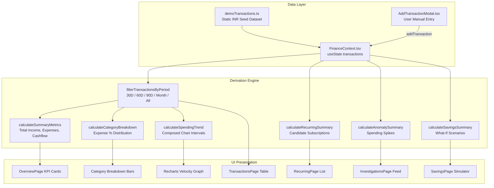

# Finora — Consolidated Product Specification & Implementation Status

> **Document Status**: Canonical Source of Truth  
> **Last Verified**: 2026-11-04 (Phase 07: Backend Integration & Persistent User Data)  
> **Git Branch**: `main`  
> **Author**: Lead Software Architect  

---

## 1. Product Summary

**Finora** (formerly developed under the working title SpendSleuth) is a personal finance intelligence platform created specifically for college students, interns, and early-career professionals. 

Unlike traditional passive expense trackers or complex corporate accounting tools, Finora is designed around an **investigation-to-action workflow**:
- **See your money in one place**: Clear view of income and expenses without complex spreadsheet formulas.
- **Find recurring commitments**: Automatically spot repeat bills and silent subscription renewals.
- **Flag unusual spending**: Highlight transactions that deviate from typical category averages with plain-English reasons.
- **Explore realistic savings**: Test what-if spending reductions to build realistic emergency funds and student cushions.

### Core Identity
- **Product Name**: Finora
- **Positioning**: Personal Finance Intelligence
- **Brand Tagline**: *"Your money. Under investigation."*
- **Base Currency**: Indian Rupee (₹ / INR), formatted according to the Indian numbering system (`en-IN`).

---

## 2. Target Audience and Value Proposition

### Target Audience
1. **Undergraduate & Graduate Students**: Managing monthly student allowances, part-time campus gigs, academic fees, and semester textbook expenses.
2. **Interns & Early-Career Professionals**: Receiving their first software engineering or corporate stipends/salaries, facing new living expenses, rent, and subscription accumulation.
3. **Budget Beginners**: Individuals who want total clarity over their personal cash flow without requiring finance degrees, accounting jargon, or risky bank password sharing.

### Key Value Propositions
- **Zero Credential Risk**: No third-party bank credential scraping or selling of user data. Supports manual entries and standard bank CSV file exports.
- **Beginner-Friendly Language**: All findings are expressed in plain, natural English rather than financial jargon or statistical terms.
- **Deterministic Explainability**: Clear mathematical justifications for every flagged transaction—no black-box predictions.

---

## 3. Brand and Design System

The application features a dual-theme architectural visual system:

### Light Editorial Theme (Public Landing Page & Dashboard Workspace)
- **Surfaces**: Warm off-white background (`#FBFBFA`), clean white cards (`#FFFFFF`), muted neutral card fills (`#F5F5F0`).
- **Accents**: Deep forest green (`#153326`, `#1B4332`), sage green (`#52796F`, `#E3ECE8`), alert amber (`#C97A2B`), alert red (`#B83A2E`).
- **Typography**:
  - Display & Headlines: **Newsreader** (refined editorial serif with italic emphasis).
  - UI & Data: **Inter** (clean, high-legibility geometric sans-serif).
  - Metrics, Tags & Currency: **JetBrains Mono** (crisp monospaced figures).
- **Styling Tokens**: Tailwind CSS v4 directives defined in `client/src/index.css`.
- **Motion**: Framer Motion entrance reveals and layout transitions with strict `prefers-reduced-motion` compliance.

### Dark Forensic Theme (Authentication Experience: `/login` & `/register`)
- **Surfaces**: Deep forest-black canvas (`#070E0B`), dark green container cards (`#0D1A14`), subtle borders (`#193224`).
- **Accents**: White primary text (`#FFFFFF`), muted sage secondary text (`#8B9E94`), pine accents (`#1B4332`, `#255C45`).
- **Layout**: Desktop split-screen layout (form on left, illustrative financial value statement on right) with single-column responsive mobile focus.

---

## 4. Core Features & Current Implementation Status

| Core Feature | User Problem Addressed | Implemented UI | Implemented Logic | Current Data Source | Limitations / Pending Work | Status |
|---|---|---|---|---|---|---|
| **A. Money Ledger** | Scattered bank statements, messy CSVs, fear of double-counting transactions. | Filterable table, search bar, category & type filters, summary stat cards, Add/Edit Transaction modal, CSV Import modal. | Search matching, type/category filtering, period date-window filtering, manual CRUD, CSV parsing with deduplication. | Persistent MongoDB backend (`/api/transactions`) when authenticated, safe `localStorage` fallback in demo mode. | Live banking AA APIs out of scope for Phase 07. | **Fully Implemented** |
| **B. Recurring Payment Detective** | Subscription creep and forgotten monthly recurring charges draining student budgets. | List of detected recurring subscriptions, cadence badges, confidence tags, next expected date cards, review actions. | Deterministic cadence clustering algorithm over canonical ledger, monthly/annual commitment calculations. | Derived from canonical Money Ledger + persisted review decisions in MongoDB (`/api/reviews/recurring`). | Local demo fallback available. | **Fully Implemented** |
| **C. Spending Anomaly Radar** | Unnoticed high-spend outliers and unexpected charges distorting monthly budgets. | Dynamic forensic feed, severity pills, ratio badges, evidence quality indicators, review/dismiss actions with undo toast, forensic evidence drawer. | Pure deterministic rolling baseline engine (`anomalyDetection.ts`), multi-tier baseline, MAD, zero-variance protection. | Derived from canonical Money Ledger + persisted review decisions in MongoDB (`/api/reviews/anomaly`). | Local demo fallback available. | **Fully Implemented** |
| **D. Savings Opportunity Lab** | Difficulty visualizing how small daily spending cuts translate into realistic savings. | Action cards (discretionary trim, subscription review, merchant frequency, anomaly remediation), plan/dismiss controls. | Discretionary category trims (uniform 10% target), zero-speculative fees, isolated user commitments. | Derived from canonical Money Ledger + persisted plan decisions in MongoDB (`/api/reviews/savings`). | Local demo fallback available. | **Fully Implemented** |
| **E. Backend & User Persistence (Phase 07)** | Multi-device access, account security, and persistent user data isolation. | Authenticated workspace indicator, login/register forms with server validation, logout trigger. | Express 4 + Mongoose 8 REST API, bcrypt password hashing, HttpOnly JWT cookies, user-scoped queries. | MongoDB service (`mongodb://127.0.0.1:27017/finora`). | Cloud deployment (Render/Atlas) planned for Phase 08+. | **Fully Implemented** |

---

## 5. Verified Technology Stack

| Layer | Technology | Version | Purpose / Configuration |
|---|---|---|---|
| **Runtime** | Node.js | `v24.13.0` | Modern LTS JavaScript runtime environment |
| **Package Manager** | npm | `11.6.2` | Workspace package management |
| **Frontend Framework** | React | `^19.3.1` | View rendering with strict hooks compliance |
| **Language** | TypeScript | `~7.0.2` | Strict end-to-end type safety |
| **Build Tool** | Vite | `^8.3.5` | Fast HMR dev server & production bundling |
| **Styling** | Tailwind CSS | `^4.3.3` | Utility-first styling via `@tailwindcss/vite` |
| **Routing** | React Router | `^7.18.5` | Client-side routing with `BrowserRouter` |
| **Animations** | Framer Motion | `^14.9.0` | Restrained UI transitions with reduced-motion support |
| **Charts** | Recharts | `^3.10.1` | SVG composed bar & line trend visualizations |
| **Icons** | Lucide React | `^1.66.0` | Clean, modern feather icon set |
| **Linter** | Oxlint | `^1.89.0` | Ultra-fast Rust-based static code analysis |
| **Database Engine** | MongoDB Server | `v8.2.5` | Local Windows service running on port 27017 (*backend integration pending*) |

---

## 6. Repository Structure

```
D:\SyntaxError\
├── .gitignore                          # Standard exclusion rules (node_modules, dist, .env)
├── package.json                        # Root workspace manager with convenience scripts
├── package-lock.json                   # Root dependency lockfile
├── docs/
│   └── PROJECT_STATUS.md               # Canonical project status document (this file)
├── client/                             # Frontend React 19 application
│   ├── .oxlintrc.json                  # Linter configuration
│   ├── index.html                      # Entry HTML with Google Fonts preconnect
│   ├── package.json                    # Client dependencies & scripts
│   ├── package-lock.json               # Client dependency lockfile
│   ├── tsconfig.json                   # TypeScript project references
│   ├── tsconfig.app.json               # Client TypeScript compiler settings
│   ├── tsconfig.node.json              # Node TypeScript settings
│   ├── vite.config.ts                  # Vite + Tailwind + Proxy configuration
│   ├── public/
│   │   ├── favicon.svg                 # Custom Finora reticle icon
│   │   └── icons.svg
│   └── src/
│       ├── main.tsx                    # React DOM root render
│       ├── App.tsx                     # Top-level client router
│       ├── index.css                   # Tailwind v4 theme directives & tokens
│       ├── types/                      # Shared domain interfaces
│       │   ├── finance.ts              # Transaction, Category, Metric, & Scenario types
│       │   └── landing.ts              # Landing page types
│       ├── lib/                        # Business logic & utilities
│       │   ├── formatCurrency.ts       # Central INR currency formatter (en-IN)
│       │   └── financeCalculations.ts  # Financial math, filtering, & metric derivations
│       ├── data/
│       │   └── demoTransactions.ts     # Realistic INR student persona dataset (Case #4029)
│       ├── context/                    # State management
│       │   ├── financeContextDef.ts    # React Context type definition
│       │   ├── FinanceContext.tsx      # In-memory finance state provider
│       │   └── useFinance.ts           # Custom consumer hook
│       ├── services/
│       │   └── authService.ts          # Client-side validation & preview status
│       ├── components/
│       │   ├── common/                 # Shared UI elements
│       │   │   ├── BrandLogo.tsx       # Finora reticle icon & wordmark
│       │   │   ├── Navbar.tsx          # Public header navigation
│       │   │   ├── Footer.tsx          # Public footer with privacy commitments
│       │   │   └── AuthPlaceholderModal.tsx
│       │   ├── landing/                # Public marketing sections
│       │   │   ├── Hero.tsx            # Headline, eyebrow pill, CTAs, grid accents
│       │   │   ├── DashboardPreview.tsx# Interactive Finora/Steep preview in INR
│       │   │   ├── HowItWorks.tsx      # 3-step beginner-friendly workflow
│       │   │   ├── FeatureShowcase.tsx # 4 core feature deep-dive cards
│       │   │   ├── InteractiveScenarioTester.tsx # Sandbox savings slider
│       │   │   └── ClosingCTA.tsx      # Closing action banner
│       │   └── app/                    # Application workspace components
│       │       ├── AppLayout.tsx       # Sidebar navigation, top bar, & mobile menu
│       │       ├── AddTransactionModal.tsx # Manual transaction entry dialog
│       │       └── ImportModal.tsx     # CSV import specification modal (placeholder)
│       └── pages/
│           ├── LandingPage.tsx         # Public marketing page route
│           ├── LoginPage.tsx           # Dedicated dark authentication page
│           ├── RegisterPage.tsx        # Dedicated dark registration page
│           ├── NotFoundPage.tsx        # Accessible 404 handler
│           └── app/                    # Authenticated dashboard views
│               ├── OverviewPage.tsx    # Summary metrics, charts, & recent items
│               ├── TransactionsPage.tsx# Money Ledger view with search & filters
│               ├── RecurringPage.tsx   # Recurring Payment Detective view
│               ├── InvestigationsPage.tsx # Spending Anomaly Radar view
│               ├── SavingsPage.tsx     # Savings Opportunity Lab simulator
│               └── SettingsPage.tsx    # Preferences & ledger reset utility
```

---

## 7. Verified Inventory of Critical Files

| Area | File Path | Actual Responsibility | Verified Status |
|---|---|---|---|
| **Routing** | `client/src/App.tsx` | Declares client routes (`/`, `/login`, `/register`, `/app/*`, `*`) using React Router. | Verified functional |
| **State** | `client/src/context/FinanceContext.tsx` | Manages in-memory `transactions` array, active period filter, and modal triggers. | Verified functional (in-memory) |
| **Calculations** | `client/src/lib/financeCalculations.ts` | Calculates income, expenses, cashflow, category splits, and trend intervals. | Verified functional |
| **Currency** | `client/src/lib/formatCurrency.ts` | Formats numbers in Indian Rupees (`₹`) via `Intl.NumberFormat('en-IN')`. | Verified functional |
| **Demo Data** | `client/src/data/demoTransactions.ts` | 624 lines of realistic student/intern transactions (Feb–Apr 2026). | Verified functional |
| **Auth UI** | `client/src/pages/LoginPage.tsx` | Dedicated dark login view with client validation, show/hide password, and demo bypass. | Verified functional (client only) |
| **Auth UI** | `client/src/pages/RegisterPage.tsx` | Dedicated dark register view with validation for name, email, and password matching. | Verified functional (client only) |
| **Auth Logic** | `client/src/services/authService.ts` | Client-side email, password, and registration validation rules. | Verified functional (no backend) |
| **Landing** | `client/src/pages/LandingPage.tsx` | Public editorial showcase assembling Hero, Preview, Features, and Sandbox. | Verified functional |
| **Hero** | `client/src/components/landing/Hero.tsx` | Clean centered serif headline, eyebrow badge, CTAs, and responsive grid markers. | Verified functional |
| **Preview** | `client/src/components/landing/DashboardPreview.tsx` | Reusable dashboard mock displaying INR outflow, subscriptions, and anomalies. | Verified functional |
| **Workspace Shell** | `client/src/components/app/AppLayout.tsx` | Sidebar with module links, active badges, period switcher, and demo banner. | Verified functional |
| **Dashboard** | `client/src/pages/app/OverviewPage.tsx` | Finora-inspired analytics hierarchy: KPI cards, Recharts composed chart, category breakdown. | Verified functional |
| **Ledger Page** | `client/src/pages/app/TransactionsPage.tsx` | Searchable transaction table with type and category filtering in INR. | Verified functional |
| **Add Tx Modal** | `client/src/components/app/AddTransactionModal.tsx` | Form to manually add transactions to the in-memory React state. | Verified functional |
| **Import Modal** | `client/src/components/app/ImportModal.tsx` | Informational modal displaying drag-and-drop UI and Phase 03 engine specs. | Visual placeholder |

---

## 8. Actual Routes and User Journeys

| Route | View Component | Status | Behavior Upon User Visit |
|---|---|---|---|
| `/` | `LandingPage.tsx` | **Functional** | Renders public landing page. Navigation links smooth-scroll to sections. "Log in" routes to `/login`; "Get started" & "Start investigating" route to `/register`. "Explore product" routes to `/app`. |
| `/login` | `LoginPage.tsx` | **Functional (Client-Side)** | Renders dark login interface. Form validates email format and password length. Submitting displays an honest local preview notice and an immediate *"Enter Interactive Workspace (/app)"* button. |
| `/register` | `RegisterPage.tsx` | **Functional (Client-Side)** | Renders dark registration interface with name, email, and password match validation. Submitting displays preview notice and direct demo access button. |
| `/app` | `OverviewPage.tsx` | **Functional (Demo Data)** | Renders primary dashboard overview with 4 KPI cards, period tabs (`30D`, `60D`, `90D`, `THIS_MONTH`, `ALL`), Recharts trend chart, and recent ledger entries. |
| `/app/transactions` | `TransactionsPage.tsx` | **Functional (In-Memory)** | Displays all active transactions in a table. Supports live search by description/note, filter by Income/Expense, and filter by Category. |
| `/app/recurring` | `RecurringPage.tsx` | **Functional (Demo Data)** | Displays detected recurring candidate cards with cadence intervals, repeat confidence percentages, and projected next billing dates. |
| `/app/investigations` | `InvestigationsPage.tsx` | **Functional (Demo Data)** | Displays flagged anomaly transactions with ratio to category baseline and plain-language explanations. |
| `/app/savings` | `SavingsPage.tsx` | **Functional (Interactive)** | Interactive what-if simulation sliders for dining reduction and meal prep with real-time projected monthly, 6-month, and 1-year savings calculations. |
| `/app/settings` | `SettingsPage.tsx` | **Functional (Client-Side)** | Allows selecting default reporting period, inspecting currency standard (INR), and resetting the in-memory ledger back to default seed data. |
| `*` | `NotFoundPage.tsx` | **Functional** | Renders accessible 404 page with a direct button back to `/`. |

> [!NOTE]
> Authentication is **not currently enforced as a hard gate** before accessing `/app`. This intentional design allows immediate evaluation of the application workspace during development.

---

## 9. Authentication Implementation Status

- **Current Architecture**: Fully client-side authentication interface.
- **Components**: Dedicated dark pages at `/login` and `/register`.
- **Validation**: Strict client-side validation via `authService.ts`:
  - Email format verification via regular expression.
  - Password minimum length verification (8+ characters).
  - Full name non-empty check on registration.
  - Password and confirm password exact match verification.
- **Backend / Session State**: No backend server, session cookies, or JWT tokens are currently implemented.
- **Integrity**: Submitting the form does not simulate a fake successful database query; instead, it transparently confirms client validation and presents a clear button to access `/app`.

---

## 10. Financial Data Flow and Persistence Model



### Persistence Reality
- **Storage Type**: **In-Memory React State Only**.
- **Data Mutation**:
  - Calling `addTransaction(...)` prepends an item with ID `tx-user-${Date.now()}` to `transactions`.
  - All derived metrics (`metrics`, `categoryBreakdown`, `trendData`, and `filteredTransactions`) update reactively across the dashboard.
- **Data Loss Boundary**: Refreshing the browser tab or closing the window completely clears user-added transactions and resets the state to `DEMO_TRANSACTIONS`.

---

## 11. Currency and Calculation Conventions

- **Locale & Standard**: Indian English (`en-IN`), Indian Rupee symbol (`₹`), ISO code `INR`.
- **Grouping Rule**: Indian two-digit grouping format (e.g., `₹1,25,000` rather than `₹125,000`).
- **Formatter**: Centralized in `client/src/lib/formatCurrency.ts`:
  - Standard format: `formatCurrency(amount)` $\rightarrow$ `₹48,650` (rounded integer).
  - Decimal format: `formatCurrency(amount, { withDecimals: true })` $\rightarrow$ `₹199.00`.
  - Signed format: `formatCurrency(amount, { showSign: true })` $\rightarrow$ `+₹45,000`.
  - Compact format: `formatCurrency(amount, { compact: true })` $\rightarrow$ `₹1.5L` for values $\ge 1,00,000$.
- **Accounting Sign Conventions**:
  - `amount`: Always stored as a non-negative number in INR units.
  - `type: 'income'`: Summed into Total Income (inflow).
  - `type: 'expense'`: Summed into Total Expenses (outflow).
  - `netCashflow`: Defined as $\text{Total Income} - \text{Total Expenses}$.

---

## 12. Known Bugs, Technical Debt, and Limitations

1. **No Data Persistence**: Transactions added via the UI disappear upon page reload.
2. **Missing Transaction CRUD**:
   - Users cannot edit existing transactions.
   - Users cannot delete transactions.
3. **CSV Import Is a Visual Placeholder**: The `ImportModal` UI presents a mock drop-zone and architectural principles, but no file parser, column mapping engine, or row commitment logic exists.
4. **Static Detection Engines**:
   - `calculateRecurringSummary` reads a fixed array (`DEMO_RECURRING_CANDIDATES`). Adding a new repeating transaction does not dynamically compute a recurrence cadence.
   - `calculateAnomalySummary` only inspects transactions hardcoded with `isAnomaly: true`. Adding an unusually large transaction does not trigger a dynamic z-score outlier alert.
5. **Static Savings Scenarios**: `savingsSummary` in `FinanceContext` is memoized with an empty dependency array `[]`.
6. **Redundant Root Dependency**: Root `package.json` contains `"react-router-dom"` in its dependencies in addition to `client/package.json`.
7. **No Server Backend**: The `/server` directory has not yet been scaffolded; all database and auth models are currently client-side.

---

## 13. Verification Results and Project Health

- **Date of Verification**: 2026-11-02
- **TypeScript Compilation**: `tsc -b` completed with **0 errors**.
- **Production Build**: `vite build` completed in **977ms** with **0 build errors**.
- **Static Code Analysis**: `oxlint` completed in **57ms** across 35 files with **0 warnings and 0 errors**.
- **HTTP Endpoint Verification**: Automated probe on port 4173 confirmed **200 OK** on all routes (`/`, `/login`, `/register`, `/app`, `/app/transactions`, `/app/recurring`, `/app/investigations`, `/app/savings`, `/app/settings`).

---

## 14. Current Git and Implementation Caveats

- **Active Branch**: `main`.
- **Working Tree**: Completely clean, tracking `origin/main` at commit `f4e7fe0`.
- **Preserved Artifacts**:
  - `SyntaxError/.git-backup/` exists as a historical backup directory.
  - Root `package-lock.json` and `client/package-lock.json` are maintained.

---

## 15. Phase 03 Scope Recommendation (The Money Ledger Foundation)

To build a robust foundation before tackling recurring payments and anomaly detection, **Phase 03 must focus strictly on the Money Ledger**:

### Recommended Scope for Phase 03:
1. **Client-Side Persistence Layer**: Implement `localStorage` or `IndexedDB` caching in `FinanceContext` so transactions persist across browser reloads.
2. **Complete Transaction CRUD**:
   - Add **Edit Transaction** modal.
   - Add **Delete Transaction** confirmation dialog with undo toast.
3. **Enhanced Ledger Table Controls**:
   - **Multi-column sorting** (sort by date, amount, merchant).
   - **Custom Date Range Filter** (start date and end date pickers).
   - **Pagination or Virtualized Scrolling** (for datasets with 100+ transactions).
4. **Real CSV Import Engine**:
   - Integrate client-side CSV parsing (e.g., `PapaParse`).
   - Build an interactive **Column Mapping Modal** (map Date, Description, Amount, Category).
   - Support standard bank exports (HDFC, ICICI, SBI, Axis, generic CSV).
5. **Fingerprint Deduplication**:
   - Generate a compound hash (`date + amount + normalizedMerchant`) to flag duplicate transactions during import.
   - Provide a review dialog: *Skip Duplicates (Default)* vs *Import All*.
6. **Polished State Handling**:
   - Empty state illustrations when no transactions match search filters.
   - Form validation error tooltips.

---

## 16. Staged Roadmap for Remaining Phases

- **Phase 03: Canonical Money Ledger, Full CRUD, & Real CSV Import Engine**
- **Phase 04: Recurring Payment Detective** (Cadence clustering algorithms, interval regularity tolerance, subscription review lifecycle).
- **Phase 05: Spending Anomaly Radar** (Dynamic rolling 60-day baselines, z-score outlier detection, velocity spike recognition, explainability drawer).
- **Phase 06: Savings Opportunity Lab & Action Loop** (Dynamic plan commitments, progress tracking against ledger transactions, 1-click conversion from anomalies/subscriptions).
- **Phase 07: Backend API & MongoDB Persistence** (Express server, JWT authentication, multi-tenant isolation, final competition hardening).

---

## 17. Explicitly Deferred Work and Non-Goals

- **No Direct Bank Screen-Scraping / Live Plaid Sync**: Unnecessary liability and out of scope for student privacy. CSV export and manual entry remain the primary ingestion paths.
- **No Cryptocurrency or Foreign Exchange Trading**: Base application is exclusively denominated in Indian Rupees (INR ₹).
- **No Speculative "AI Advice" Claims**: Finora uses deterministic mathematical rules, rolling averages, and statistical thresholds. No black-box generative AI advice is used for financial decisions.
- **No External Cloud User Data Selling**: Built with local-first, privacy-respecting principles.

---

## 18. Phase 05 Implementation Summary (Spending Anomaly Radar Engine)

Completed and verified on 2026-11-02:
1. **Detection Engine (`client/src/lib/anomalyDetection.ts`)**: Pure deterministic anomaly detector computing rolling 60-day historical baselines strictly preceding evaluated transactions (zero lookahead leakage). Uses multi-tier grouping (merchant -> category -> personal discretionary) and robust statistics (Median Absolute Deviation, Bessel-corrected standard deviation, zero-variance protection). Assigns severity (`high`, `medium`, `low`) and evidence quality (`high`, `moderate`, `preliminary`).
2. **Review State Persistence (`client/src/lib/anomalyStorage.ts`)**: Namespaced storage under `finora.anomalyReviews.v1` with corruption backup (`finora.anomalyReviews.v1.corrupt_backup`), deterministic key generation (`anom-${txId}-${ruleId}`), and safe read/write/delete/clear routines.
3. **Context & State Integration**: Extended `FinanceContext` and `financeContextDef.ts` to expose `anomalyAnalysis`, `reviewAnomalyFinding`, `dismissAnomalyFinding`, `reinstateAnomalyFinding`, and `resetAnomalyReviews`. Automatically updates upon transaction CRUD, CSV imports, and demo resets.
4. **Interactive Radar UI (`client/src/pages/app/InvestigationsPage.tsx`)**: Replaced static demo cards with dynamic findings, summary KPI strip, category/severity filters, sort dropdown, review/dismiss actions with undo toasts, and an expandable forensic evidence drawer displaying sample count, mean, median, std dev, MAD, and historical comparables.
5. **Quality & Verification**: 21/21 automated verification tests passed covering all Section 14 requirements. Zero TypeScript compilation errors and zero Oxlint linter warnings across 46 files.
